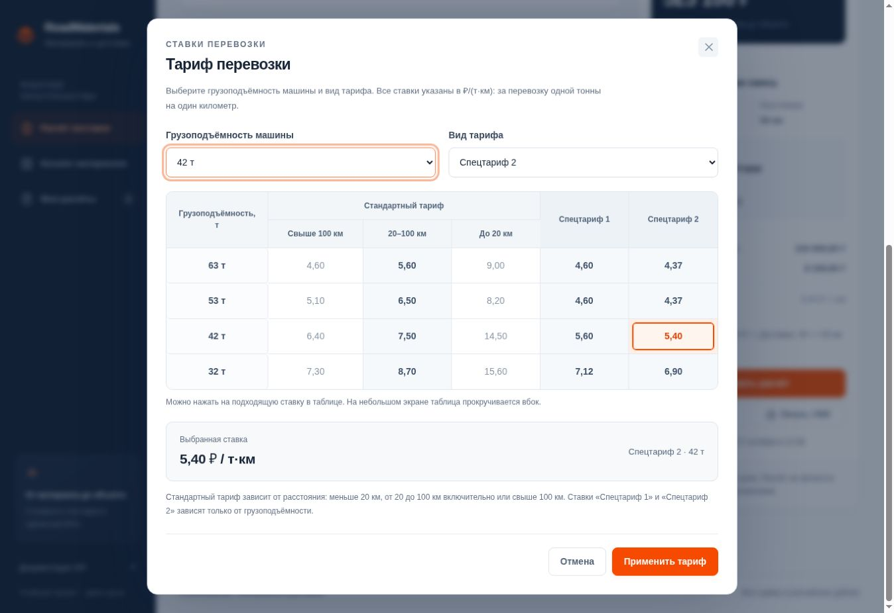
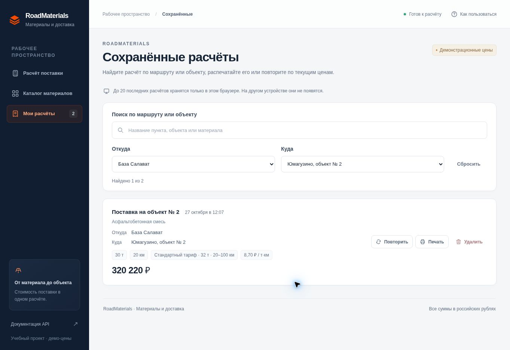

# RoadMaterials API

[](https://github.com/4122312421/road-materials-Api1/actions/workflows/ci.yml)

Учебный проект по дисциплине «Инфраструктура и администрирование».
FastAPI-сервис помогает сотруднику коммерческого отдела просмотреть каталог
строительных материалов и рассчитать стоимость материала и его доставки
по маршруту и выбранному тарифу перевозки.


## Работа в интерфейсе

После запуска приложения откройте [RoadMaterials](http://127.0.0.1:8000/) в браузере.
Для расчёта не нужно писать код или JSON:

1. Выберите материал на карточке.
2. При необходимости заполните **«Откуда везём»**, **«Куда везём»** и название объекта.
3. Введите количество в тоннах и расстояние доставки в километрах.
4. Нажмите **«Выбрать тариф»**: откроется таблица ставок. Выберите грузоподъёмность
   машины и стандартный тариф, **«Спецтариф 1»** или **«Спецтариф 2»**,
   затем нажмите **«Применить тариф»**.
5. Нажмите **«Рассчитать стоимость»** и посмотрите отдельно стоимость материала,
   доставку и общую сумму.

В полях количества и расстояния можно использовать запятую или точку, например
`30,5` или `30.5`, — не более трёх знаков после разделителя. Значения должны быть
больше нуля. Сообщение рядом с полем подсказывает, что нужно исправить.

Пункты отправления и назначения — необязательные текстовые поля до 160 символов
каждое. Можно указать город, базу, карьер или адрес объекта. Расстояние вводится
вручную: приложение не строит маршрут на карте и не вычисляет километраж по адресам.
По умолчанию в новой форме выбран стандартный тариф для машины **42 т**.
Изменение расстояния автоматически меняет стандартную ставку по диапазону.

В разделе каталога доступны поиск и фильтр по категории. Успешный расчёт можно
скопировать, сохранить или распечатать. В окне печати браузера выберите
**«Сохранить как PDF»**, чтобы получить файл с результатом. Маршрут и выбранный
тариф входят в результат, копируемый текст и печатную форму.

Раздел сохранённых расчётов хранит последние **20** записей в `localStorage`
этого браузера для текущего адреса приложения. Записи сохраняются после
перезагрузки страницы, но не передаются на сервер и не синхронизируются между
устройствами. Очистка данных сайта удалит их. Сохранение расчёта не создаёт заявку
или заказ. При повторении расчёта стоимость заново запрашивается у сервера
по текущим ценам и тарифу; сохранённая запись содержит результат на момент сохранения.

В **«Мои расчёты»** доступны поиск по маршруту или объекту и отдельные фильтры
по пункту отправления и назначения. Фильтры можно сочетать. Кнопка **«Сбросить»**
возвращает полный список. Ранее сохранённые расчёты без маршрута остаются доступны;
по кнопке **«Повторить»** они пересчитываются по текущему базовому тарифу из настроек.
Затем при необходимости можно выбрать тариф из таблицы и пересчитать результат.
Для новых записей повторение восстанавливает маршрут, вид тарифа и грузоподъёмность.

**Пример для проверки:** асфальтобетонная смесь, **30 т**, **50 км**, машина **42 т**,
**стандартный тариф 7,50 ₽/(т·км)**. Материал — **315 000 ₽**, доставка — **11 250 ₽**,
итого — **326 250 ₽**.

### Выбор тарифа



### Поиск сохранённых расчётов по маршруту



## Возможности

- Пользовательский интерфейс с карточками материалов, формой и разбивкой стоимости.
- Каталог материалов, поиск в интерфейсе и фильтрация по категории.
- Получение материала по идентификатору.
- Таблица ставок для машин 32, 42, 53 и 63 т, стандартный тариф и два спецтарифа.
- Расчёт стоимости заказа с доставкой по тарифу за тонно-километр.
- Пункты отправления и назначения в форме, результате и печатном расчёте.
- Сохранение расчётов в браузере, поиск по маршруту и фильтрация по обоим пунктам.
- Повторный расчёт, копирование результата и печать.
- Проверка работоспособности и версии приложения.
- Валидация запросов, логирование, автоматические тесты и GitHub Actions CI.

Цены демонстрационные. Каталог хранится в памяти приложения и задаётся в коде.
Расстояние вводит пользователь. Модель не учитывает обратный рейс, простой,
минимальную загрузку машины, количество рейсов и дополнительные расходы.

## Тарифы перевозки

Ставки таблицы используются в **₽/(т·км)**. В интерфейсе таблица открывается
при выборе тарифа; соответствующая выбранным параметрам ячейка выделяется.
Таблица применяется **ко всем материалам каталога**, включая асфальтобетонную
смесь, щебень и песок.

| Грузоподъёмность машины, т | Свыше 100 км | 20–100 км | До 20 км | Спецтариф 1 | Спецтариф 2 |
|---:|---:|---:|---:|---:|---:|
| 63 | 4,60 | 5,60 | 9,00 | 4,60 | 4,37 |
| 53 | 5,10 | 6,50 | 8,20 | 4,60 | 4,37 |
| 42 | 6,40 | 7,50 | 14,50 | 5,60 | 5,40 |
| 32 | 7,30 | 8,70 | 15,60 | 7,12 | 6,90 |

Правила расчётной модели:

- **Стандартный тариф** определяется грузоподъёмностью и расстоянием.
  «До 20 км» означает расстояние **меньше 20 км**; **20 и 100 км включительно**
  относятся к диапазону «20–100 км»; расстояние больше 100 км — к последнему диапазону.
- **«Спецтариф 1»** и **«Спецтариф 2»** определяются грузоподъёмностью и не меняют
  ставку при смене диапазона расстояния. Само расстояние продолжает участвовать
  в формуле стоимости доставки.
- Грузоподъёмность выбирается отдельно от общего количества материала в заказе.
  Заказ может быть больше грузоподъёмности одной машины; количество машин и рейсов
  приложение не рассчитывает.
- Итоговую ставку и стоимость выбирает сервер. Клиент передаёт вид тарифа,
  грузоподъёмность, количество и расстояние, а не произвольную цену.
- Для запросов старого формата и ранее сохранённых расчётов доступен
  **базовый тариф** из `DELIVERY_RATE`. Он не зависит от грузоподъёмности.

## Быстрый запуск на macOS

Нужны Git и Python 3.13 — эта же версия Python используется в CI.
Интерфейс раздаёт само FastAPI-приложение: Node.js, npm и Streamlit не нужны.
Команды выполняются в терминале:

```bash
git clone https://github.com/4122312421/road-materials-Api1.git road-materials-api
cd road-materials-api
python3.13 -m venv .venv
source .venv/bin/activate
python -m pip install -r requirements-dev.txt
export APP_VERSION=0.1.0
export DELIVERY_RATE=7.5
python -m uvicorn app_final:app --host 127.0.0.1 --port 8000
```

Оставьте терминал с сервером открытым. В браузере доступны:

- [Главная страница — интерфейс расчёта поставки](http://127.0.0.1:8000/).
- [Swagger UI — описание и проверка API](http://127.0.0.1:8000/docs).
- [Проверка работоспособности](http://127.0.0.1:8000/health).
- [Версия приложения](http://127.0.0.1:8000/version).

В Swagger UI выберите маршрут, нажмите **Try it out**, заполните параметры
и нажмите **Execute**. Остановка сервера — **Ctrl+C** в терминале с Uvicorn.
Для повторного запуска откройте папку проекта, активируйте `.venv` и выполните
команду `python -m uvicorn app_final:app --host 127.0.0.1 --port 8000`.

## Как устроено приложение

FastAPI раздаёт главную HTML-страницу и файлы CSS/JavaScript из `static/`.
JavaScript получает каталог через `GET /materials`, таблицу ставок через
`GET /tariffs`, а введённые пользователем параметры отправляет в
`POST /delivery/calculate`. Форма использует тот же API, который доступен в `/docs`.
Маршрут `GET /pricing` продолжает возвращать базовый тариф из окружения.

Стоимость вычисляется на сервере с помощью `Decimal`; браузер отображает ответ.
При изменении параметров результат нужно пересчитать. Сохранённые записи находятся
только в браузере. Печать и сохранение в PDF используют возможности браузера,
поэтому отдельная библиотека для генерации PDF не требуется.

## Настройки через окружение

| Переменная | Значение по умолчанию | Назначение |
|---|---|---|
| `APP_VERSION` | `0.1.0` | Версия в `/version` и Swagger UI |
| `DELIVERY_RATE` | `7.5` | Базовый тариф, ₽/(т·км), для режима `default` |

`DELIVERY_RATE` должен быть положительным числом с точкой в качестве
десятичного разделителя: до двух знаков после точки и шести до неё.
Некорректный тариф вызывает ошибку валидации при запуске.
Эта настройка применяется к запросам без выбора тарифа или с
`"tariff_mode":"default"`. Стандартные ставки и два спецтарифа из таблицы
от `DELIVERY_RATE` не зависят.

[`.env.example`](.env.example) содержит образец настроек. Приложение читает
переменные через `os.getenv`; файл `.env` автоматически не загружается.
Для настройки используйте команды `export`, показанные выше.
Значения считываются при запуске: после изменения окружения перезапустите сервер.

Пример проверки другого базового тарифа: остановите сервер через **Ctrl+C** и выполните:

```bash
export DELIVERY_RATE=8
python -m uvicorn app_final:app --host 127.0.0.1 --port 8000
```

Для заказа старого формата из примера API ниже доставка станет `12000.00`,
итог — `327000.00`. Если в интерфейсе выбран стандартный тариф или спецтариф,
изменение `DELIVERY_RATE` не меняет его ставку.
Чтобы вернуть исходный тариф, установите `export DELIVERY_RATE=7.5`
и снова перезапустите сервер.

## Маршруты API

| Метод | Маршрут | Назначение |
|---|---|---|
| GET | `/` | Пользовательский HTML-интерфейс; не включён в Swagger UI |
| GET | `/health` | Ответ `{"status":"ok"}` |
| GET | `/version` | Текущая версия, например `{"version":"0.1.0"}` |
| GET | `/pricing` | Базовый тариф и валюта, например `{"delivery_rate":"7.5","currency":"RUB"}` |
| GET | `/tariffs` | Полная таблица ставок, грузоподъёмности, единица расчёта и базовый тариф |
| GET | `/materials` | Все материалы; необязательный query-параметр `category` |
| GET | `/materials/{material_id}` | Материал по положительному целому ID |
| POST | `/delivery/calculate` | Расчёт по JSON с материалом, объёмом, расстоянием, видом тарифа и маршрутом |

Категории: `asphalt` и `aggregate`. Неизвестная категория возвращает пустой список.
Неизвестный положительный ID возвращает `404` с сообщением `Материал не найден`.
Некорректные параметры возвращают `422` с описанием ошибки в `detail`.

### Учебный каталог

| ID | Наименование | Категория | Цена, ₽/т |
|---|---|---|---:|
| 1 | Асфальтобетонная смесь | `asphalt` | 10 500,00 |
| 2 | Щебень 5-20 | `aggregate` | 1 600,00 |
| 3 | Песок | `aggregate` | 800,00 |

### Примеры запросов

При работающем сервере выполните в другом окне терминала:

```bash
curl http://127.0.0.1:8000/health
curl http://127.0.0.1:8000/version
curl http://127.0.0.1:8000/pricing
curl http://127.0.0.1:8000/tariffs
curl "http://127.0.0.1:8000/materials?category=aggregate"
curl http://127.0.0.1:8000/materials/1
```

Фильтр `aggregate` возвращает щебень и песок. Запрос старого формата продолжает
работать и использует базовый тариф из `DELIVERY_RATE`:

```bash
curl -X POST http://127.0.0.1:8000/delivery/calculate \
  -H "Content-Type: application/json" \
  -d '{"material_id":1,"quantity_tons":30,"distance_km":50}'
```

Ответ при тарифе `7.5`:

```json
{
  "material_id": 1,
  "material_name": "Асфальтобетонная смесь",
  "quantity_tons": "30",
  "distance_km": "50",
  "price_per_ton": "10500.00",
  "delivery_rate": "7.5",
  "material_cost": "315000.00",
  "delivery_cost": "11250.00",
  "total_cost": "326250.00",
  "currency": "RUB",
  "tariff_mode": "default",
  "tariff_name": "Базовый тариф",
  "vehicle_capacity_tons": null,
  "distance_band": null,
  "origin": "",
  "destination": ""
}
```

Расчёт: материал = `10500 × 30 = 315000 ₽`; доставка = `7.5 × 30 × 50 = 11250 ₽`;
итого = `326250 ₽`. Стоимость материала и доставки округляется отдельно до копеек
через `Decimal` с правилом `ROUND_HALF_UP`, затем суммы складываются.
Денежные значения возвращаются строками для сохранения десятичного представления.

Выбор тарифа и указание маршрута:

```bash
curl -X POST http://127.0.0.1:8000/delivery/calculate \
  -H "Content-Type: application/json" \
  -d '{"material_id":1,"quantity_tons":30,"distance_km":50,"tariff_mode":"special_2","vehicle_capacity_tons":42,"origin":"База Уфа","destination":"Строительный объект"}'
```

В этом примере сервер выбирает **«Спецтариф 2»** для машины **42 т**:
ставка `5.40`, доставка `8100.00`, материал `315000.00`, итог `323100.00`.
Пункты маршрута возвращаются в ответе; они не меняют арифметику расчёта.

| Поле | Допустимые значения |
|---|---|
| `tariff_mode` | `default`, `standard`, `special_1`, `special_2`; по умолчанию `default` |
| `vehicle_capacity_tons` | `32`, `42`, `53` или `63`; обязательно для `standard` и спецтарифов |
| `origin` | Пункт отправления, строка до 160 символов; необязательно |
| `destination` | Пункт назначения, строка до 160 символов; необязательно |

Пробелы по краям пунктов маршрута удаляются. Для стандартного тарифа ответ
содержит `distance_band`: `under_20`, `from_20_to_100` или `over_100`.
Для спецтарифов и базового тарифа значение `distance_band` равно `null`.

`quantity_tons` и `distance_km` должны быть больше нуля, иметь не более трёх знаков
после точки и семи до неё. В JSON `material_id` задаётся целым числом.
Лишние поля в теле запроса запрещены.

Примеры ошибок: первый запрос вернёт `404`, второй — `422` из-за нулевого объёма.

```bash
curl -i http://127.0.0.1:8000/materials/999
curl -i -X POST http://127.0.0.1:8000/delivery/calculate \
  -H "Content-Type: application/json" \
  -d '{"material_id":1,"quantity_tons":0,"distance_km":50}'
```

## Автоматические тесты

Из папки проекта с активированным `.venv`:

```bash
python -m pytest -v
```

Для сохранения XML-отчёта:

```bash
python -m pytest -v --junitxml=reports/pytest.xml
```

Отдельно запускать Uvicorn для тестов не требуется: используется `TestClient`.
Набор содержит **56 тестовых случаев** и проверяет служебные маршруты, каталог, фильтрацию,
материал по ID, неизвестные ID, расчёт, округление, ошибочные значения и тариф
из окружения. Дополнительно проверяются HTML главной страницы, доступность CSS
и JavaScript, соответствие тарифа в `/pricing` расчёту доставки, таблица ставок,
выбор ставки по грузоподъёмности и типу тарифа, границы диапазонов расстояния
и проверка полей маршрута.
Ожидаемый результат — **`56 passed`**; XML-отчёт находится в `reports/pytest.xml`.
Тесты задают собственные значения переменных окружения.

Для проверки поведения интерфейса откройте главную страницу: выполните пример
на 30 т и 50 км, проверьте подсказку при нулевом количестве, сохраните расчёт
с заполненным маршрутом и откройте его после перезагрузки страницы. Проверьте
выбор спецтарифа, смену стандартной ставки при изменении расстояния, поиск
и оба фильтра в сохранённых расчётах. Автоматические тесты FastAPI
проверяют сервер и раздачу файлов; они не заменяют проверку действий в браузере.

## GitHub Actions

Workflow [RoadMaterials CI](.github/workflows/ci.yml) запускается при `push`,
`pull_request` и вручную через **Actions → RoadMaterials CI → Run workflow**.
Он использует Ubuntu, устанавливает Python 3.13 и зависимости, затем выполняет pytest.

После успешного запуска сохраняются два артефакта:

- **`pytest-report`** — XML-отчёт о тестах.
- **`roadmaterials-app`** — файлы приложения, интерфейса, тестов, зависимостей,
  документации и конфигурации из таблицы ниже.

Результат и журналы доступны во вкладке
[Actions](https://github.com/4122312421/road-materials-Api1/actions).
Откройте запуск и задание **tests** для просмотра шагов. Артефакты скачиваются
из раздела **Artifacts** на странице результата запуска; для скачивания нужен вход в GitHub.

## Логи и диагностика

Uvicorn выводит запросы и ошибки в терминал. Приложение дополнительно записывает
события запуска и остановки, версию, тариф и параметры выполненных расчётов.
Для записи в файл остановите предыдущий сервер и запустите:

```bash
python -m uvicorn app_final:app --host 127.0.0.1 --port 8000 > app.log 2>&1
```

В другом терминале из папки проекта просматривайте журнал:

```bash
tail -f app.log
```

| Проблема | Что проверить |
|---|---|
| `No module named uvicorn` или `pytest` | Активировать `.venv`, установить `requirements-dev.txt` |
| `Could not import module "app_final"` | Выполнять запуск из папки, где лежит `app_final.py` |
| `Address already in use` | Посмотреть занятый порт: `lsof -nP -iTCP:8000 -sTCP:LISTEN`; при необходимости запустить на другом порту |
| Не открывается интерфейс | Открыть `http://127.0.0.1:8000/` и проверить, что сервер запущен; документация API находится по `/docs` |
| Страница без оформления или кнопки не работают | Убедиться, что рядом с `app_final.py` есть папка `static` с тремя файлами; проверить ошибки запросов в терминале и обновить страницу |
| Расчёты не видны в истории | Использовать тот же браузер и адрес приложения; записи хранятся в данных сайта на этом устройстве |
| Поиск или фильтры не находят запись | Нажать «Сбросить» в «Мои расчёты» и проверить, заполнены ли пункты маршрута в сохранённой записи |
| Изменение `DELIVERY_RATE` не меняет стандартный тариф | Эта переменная задаёт только базовый тариф режима `default`; ставки таблицы хранятся отдельно |
| Настройки из `.env` не применились | Использовать `export` и перезапустить сервер |
| `422` при расчёте | Проверить поля запроса и описание ошибок в `detail` |

Для другого порта: `python -m uvicorn app_final:app --host 127.0.0.1 --port 8001`.
Тогда интерфейс будет доступен по адресу `http://127.0.0.1:8001/`,
а документация — `http://127.0.0.1:8001/docs`.

Локальные `.env`, `.venv`, журналы и `reports/` исключены через `.gitignore`.
Не добавляйте в репозиторий пароли, токены и другие секреты. `.env.example`
содержит только демонстрационные настройки.

## Файлы проекта

| Файл | Назначение |
|---|---|
| [app_final.py](app_final.py) | FastAPI-приложение, каталог, тарифная таблица, расчёт и раздача интерфейса |
| [static/index.html](static/index.html) | Структура пользовательского интерфейса |
| [static/styles.css](static/styles.css) | Оформление, адаптация к экрану и печать |
| [static/app.js](static/app.js) | Работа формы и тарифной таблицы, запросы к API, поиск и фильтрация сохранённых расчётов |
| [docs/interface.jpg](docs/interface.jpg) | Скриншот работающего интерфейса |
| [docs/tariffs.jpg](docs/tariffs.jpg) | Окно выбора тарифа |
| [docs/routes-history.jpg](docs/routes-history.jpg) | Поиск и фильтры по маршруту |
| [test_app.py](test_app.py) | Автоматические тесты |
| [requirements.txt](requirements.txt) | Зафиксированные зависимости приложения |
| [requirements-dev.txt](requirements-dev.txt) | Зависимости приложения и тестирования |
| [README.md](README.md) | Инструкция по запуску, проверке и диагностике |
| [.gitignore](.gitignore) | Исключения для локальных и генерируемых файлов |
| [.env.example](.env.example) | Образец переменных окружения |
| [.github/workflows/ci.yml](.github/workflows/ci.yml) | Автоматическая проверка и сохранение артефактов |
